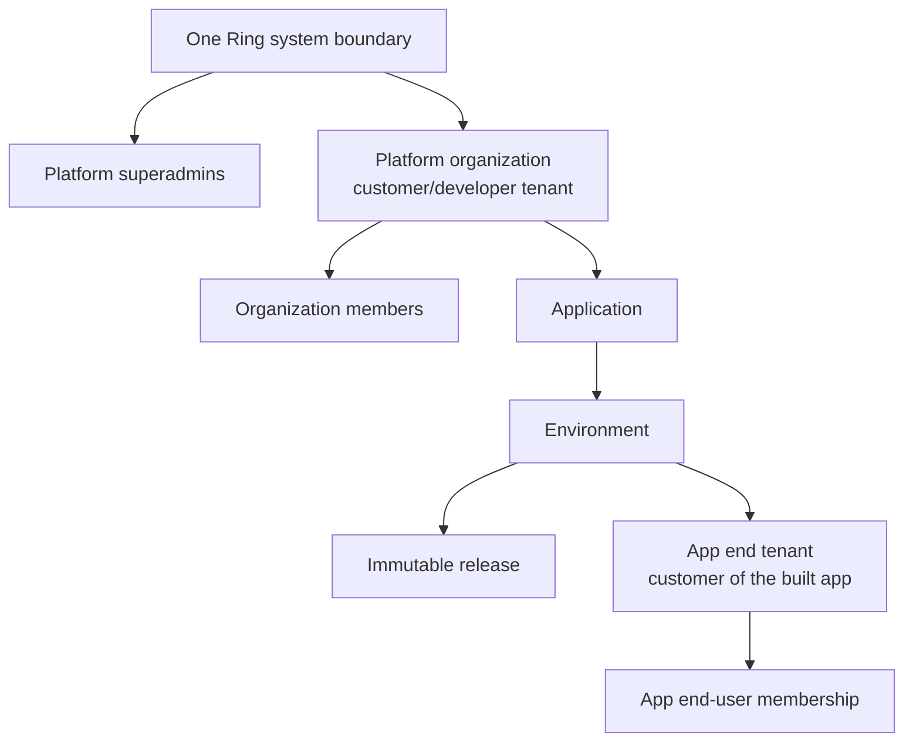
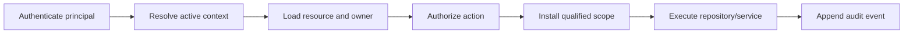

# Superadmin, customer organization, and app tenancy architecture

Status: target architecture for the next control-plane milestone.

## 1. Outcome

One Ring is a multi-tenant development and deployment platform. A customer joins
One Ring as a **platform organization**, creates projects and applications, uses
oneringai-assisted development, and deploys those applications onto One Ring's
runtime. A deployed application may itself be multi-tenant and serve many
**end-tenant organizations**.

These are different security domains:



The word `tenantId` must not appear unqualified in control-plane domain code.
Use `platformOrganizationId` for the customer that owns and develops apps and
`endTenantId` for a customer of one deployed app. `appId` and `environmentId`
must qualify all runtime resources.

## 2. Trust boundaries

### 2.1 Platform system boundary

The platform system owns global configuration, platform policies, builder
templates, infrastructure, support tooling, billing rules, and the system audit
stream. Platform superadmin access is not inherited from membership in a
customer organization.

The One Ring console is a dedicated, first-party control-plane application. It
is not a tenant-created app and is not deployed through the customer app
runtime. It may share framework-agnostic React components, design tokens, and
build libraries with tenant apps, but it has its own source, release process,
API audience, deployment identity, and infrastructure boundary.

Customer-generated code and workloads never share a process, runtime identity,
credential, or API audience with the console or control-plane service. Tenant
apps cannot be promoted into control-plane applications.

### 2.2 Platform organization boundary

A platform organization is the durable owner of apps, data, releases, billing,
secrets, and audit records. Users act through versioned memberships. Removing a
user leaves organization resources with the organization.

A user may belong to multiple platform organizations but every request has one
explicit active organization context. A resource is accessible only when both
its ownership relationship and the requested action pass authorization.

### 2.3 Application boundary

An application belongs to exactly one platform organization. An app contains
projects/specifications, environments, releases, route bindings, connector
grants, workflows, and runtime data. Moving an app between organizations is a
privileged, audited migration, not a normal update.

### 2.4 End-tenant boundary

An end tenant exists only inside one app environment. Its users, roles, data,
agent runs, workflow runs, quotas, and secrets cannot grant access to the One
Ring control plane or to another app. The same human may have a platform account
and one or more app identities, but authorization evaluates those sessions
independently.

## 3. Principals and roles

All humans, agents, workloads, and service accounts are first-class principals.
Roles compile to named permissions. Services check permissions, not UI labels or
hardcoded role names.

### 3.1 Platform roles

Platform roles are global assignments stored separately from organization
memberships.

| Role | Intended authority |
|---|---|
| `platform_root` | Bootstrap-only, all platform actions, MFA and break-glass reason required |
| `platform_operator` | Deploy/runtime operations without customer-data access by default |
| `platform_security_admin` | Policies, audit, access revocation, security incidents |
| `platform_support` | Customer metadata plus explicit time-bound support grants |
| `platform_billing_admin` | Plans, invoices, credits, and aggregate usage |

Global builder templates and connector catalog policy require
`platform.builder_system.manage`; normal authenticated users must never reach
those APIs. Root assignments cannot be created through the normal web API.

### 3.2 Platform-organization roles

| Role | Core permissions |
|---|---|
| `owner` | Organization lifecycle, owners, all organization permissions |
| `admin` | Members, apps, policies, and organization settings; no ownership transfer |
| `builder` | Create/edit apps, specifications, source, previews, and development runs |
| `release_manager` | Approve and promote immutable releases, manage routes |
| `secrets_admin` | Manage organization/app/environment connector credentials and grants |
| `billing` | Plans, limits, and organization usage |
| `viewer` | Read metadata, previews, release evidence, and permitted logs |

Start with one role per membership. Additive roles and custom roles can be added
later without changing service code because authorization is permission-based.
An organization may also grant narrower app-specific access through
`AppGrant`. An app grant is bounded by the granting administrator's authority,
applies only to that app, and can never confer platform superadmin privileges.

### 3.3 App end-user roles

End-user roles are defined and versioned by each app's policy contract. A common
starter set is `viewer`, `editor`, and `admin`, but these names have no meaning
in the control plane. End-user permissions are evaluated against
`appId + environmentId + endTenantId`.

## 4. Authorization contract

Every protected operation follows one server-owned pipeline:



1. Authenticate a user, service, workload, or agent identity.
2. Resolve the active platform organization from the session and membership,
   never solely from a request body.
3. Load the target resource and its immutable ownership chain.
4. Call `AuthorizationService.check(principal, action, resource, context)`.
5. Install a qualified request context with `AsyncLocalStorage`.
6. Repositories fail closed when a required scope is missing and inject scope
   filters/stamps themselves.
7. Append a structured audit event for mutations and sensitive reads.

Controllers must use explicit policy metadata such as
`@RequirePermission('app.release.promote')`. There is no fallback rule where
"authenticated" means authorized. Route parameters select a candidate resource;
they do not prove ownership.

The initial authorization adapter can use the existing XIAM/icos patterns and
Mongo relationships behind a stable `AuthorizationService`. The domain model
should retain organization/resource relationships so it can move to an FGA
engine later without rewriting controllers.

## 5. Identity and session contracts

Use tenant-scoped OneRingAI Google/Microsoft connectors with OAuth authorization
code flow and PKCE for browser login. A tenant admin designates an existing
connector as a login provider; the same encrypted connector configuration and
OAuth machinery used for tools performs the login exchange. No external identity
broker is part of the architecture. Optional tenant-scoped password credentials
exist for testing and are disabled by default. A control-plane
session contains only identity and the active context needed for the request:

```ts
type ControlPlaneSession = {
  subject: string;
  sessionId: string;
  activePlatformOrganizationId?: string;
  membershipId?: string;
  membershipVersion?: number;
  platformRoleVersion?: number;
  audience: 'onering-control-plane';
};
```

Permissions are resolved server-side or represented by short-lived claims and
revalidated against membership versions. Do not put every organization ID in a
long-lived token. Switching organizations rotates the session context.

Runtime sessions use a different audience and claim vocabulary:

```ts
type AppRuntimeSession = {
  subject: string;
  sessionId: string;
  appId: string;
  environmentId: string;
  endTenantId?: string;
  membershipId?: string;
  membershipVersion?: number;
  policyRevision: number;
  audience: `onering-app-runtime:${string}:${string}`; // appId:environmentId
};
```

Control-plane, workspace, build, deployment, and app-runtime tokens are
audience-restricted and cannot be replayed at another service. Workload and
agent tokens are short-lived, resource-specific, and capability-scoped.

Development-only local superadmin behavior remains permitted only when an
explicit `LOCAL_DEV_AUTH=1` flag is set, the request is loopback, and production
mode is false. It must render a persistent development-auth banner.

## 6. Core data model

Control-plane records live in the dedicated control-plane database.
Organization-owned documents always carry `platformOrganizationId` and use
compound indexes that begin with it.

| Entity | Important fields and rules |
|---|---|
| `Principal` | Human, service, workload, or agent identity; status and auth-provider links |
| `PlatformOrganization` | Customer workspace, slug, status, plan, residency, lifecycle version |
| `PlatformMembership` | Principal, organization, role key, status, version; unique membership |
| `PlatformRoleAssignment` | Global platform role, principal, expiry, grantor, reason |
| `Invitation` | Organization, email, proposed role, one-time digest, expiry, status |
| `Application` | Immutable owner organization, profile, status, public key |
| `AppGrant` | Optional app-specific principal/group permissions |
| `Environment` | App, name, isolation tier, data namespace, runtime identity |
| `SpecificationRevision` | App, immutable revision, author and approval state |
| `BuilderRun` | App/environment, pinned builder-system revision, agent identity, evidence |
| `WorkflowRevision` | App, immutable trigger/step graph or code artifact contract |
| `Release` | App/environment, immutable source/spec/policy/workflow/artifact revisions |
| `Deployment` | Environment, active release, runtime status and route bindings |
| `ConnectorAccount` | Owner scope and provider metadata; secret material stays in the vault |
| `ConnectorGrant` | Connector account to app/environment/agent/action grant |
| `AuditEvent` | Actor, active organization, resource, action, decision, correlation and reason |
| `SupportGrant` | Time-bound customer-approved or break-glass support access |

The current `ownerOrganizationId` field becomes
`platformOrganizationId`. Current app `EndTenant` and `AppMembership` records
gain `environmentId`; production and preview cannot share identity or data.

### 6.1 Mongo placement

- Control-plane metadata uses one dedicated database with mandatory
  `platformOrganizationId` scoping for customer-owned documents.
- Managed browser apps initially use pooled runtime databases and shared
  collections keyed by `appId + environmentId`, plus `endTenantId` for every
  end-tenant-scoped record.
- Higher isolation tiers use a logical database per app environment with a
  database-scoped workload identity.
- Never create one collection per end tenant. End-tenant separation is either a
  scoped field in shared collections or, for an enterprise tier, a separately
  provisioned database/cluster.
- Customer-generated code does not receive the pooled database credential. It
  uses the platform data gateway, which injects the qualified scope.

## 7. API boundaries

Use paths that make the authorization domain explicit:

```text
/api/platform/admin/...                         platform permissions only
/api/organizations/:platformOrganizationId/... organization membership required
/api/organizations/:platformOrganizationId/apps/:appId/...
/api/apps/:appId/environments/:environmentId/releases/...
/runtime/apps/:appId/environments/:environmentId/...
```

The server validates the complete parent chain. It rejects an `appId` that does
not belong to the path organization and an environment that does not belong to
the app. Create APIs derive ownership from the active authorized context rather
than accepting arbitrary owner IDs from normal tenant callers.

Split controllers/modules by trust boundary:

- `PlatformAdminModule`: global policy, builder system, operators and support;
- `OrganizationModule`: onboarding, memberships, invitations, plan and usage;
- `DevelopmentModule`: apps, specs, builders, workflows and previews;
- `ReleaseModule`: builds, evidence, environments, promotion and rollback;
- `RuntimeGatewayModule`: app identity, data, connectors and workflow execution.

## 8. Customer development and deployment flow

1. A user signs up or accepts an invitation.
2. If the user has no organization, One Ring atomically creates a platform
   organization and an `owner` membership.
3. The user selects an active organization. The console lists only resources
   authorized in that context.
4. A builder creates an app. One Ring derives its owner organization, creates
   development/preview/production environments, and provisions scoped runtime
   identities and data namespaces.
5. The tenant chooses the app audience contract: personal, team, or
   multi-organization. This controls the app's end-tenancy, not its platform
   ownership.
6. Human and oneringai builders edit the structured specification, UI modules,
   schema, policies, agent definitions, and workflows. Every run pins its
   builder-system and connector-policy revisions.
7. The verification pipeline compiles the app, runs policy and cross-tenant
   tests, scans it, and emits immutable evidence and an artifact.
8. A release manager promotes the same artifact. One Ring deploys it inside the
   platform runtime and assigns a platform path/hostname without rebuilding.
9. The deployed app onboards its own end tenants and users through the runtime
   identity boundary. Those identities never become members of the owning
   platform organization unless explicitly invited there separately.

## 9. oneringai and workflow model

Builder and runtime agents are different principals.

- Platform superadmins publish global builder templates, tool catalog policy,
  safety defaults, evaluation contracts, and approved provider/model catalog.
- Organization admins may configure allowed fields, budgets, and connector
  accounts within the extension policy exposed by the global template.
- Each builder run receives a short-lived identity restricted to one app,
  environment, source revision, workspace, and set of tools.
- Runtime agents receive an app/environment identity plus the active
  `endTenantId` when handling end-user work. Data tools and connector grants
  enforce that same scope.
- Provider credentials are resolved by the connector broker from the narrowest
  permitted scope: platform catalog -> organization account -> app/environment
  grant -> optional end-tenant account. Secrets never enter generated source or
  model prompts.

General workflows are first-class versioned app artifacts:

```ts
type WorkflowDefinition = {
  appId: string;
  revision: number;
  triggers: Array<'ui' | 'webhook' | 'schedule' | 'event'>;
  steps: Array<'code' | 'agent' | 'connector' | 'human' | 'condition'>;
  inputSchema: unknown;
  outputSchema: unknown;
  requiredPermissions: string[];
};
```

Browser-native apps execute declarative workflows through platform-hosted
workers. Full-stack apps may later package code workers, but both use the same
workflow/release/audit contract. Each run is durable, idempotent where declared,
quota-accounted to the owning platform organization, and end-tenant scoped when
triggered by an app user. A cross-end-tenant administrative workflow must
iterate explicit tenant partitions; no wildcard tenant context is allowed.

## 10. Superadmin and support safety

- Superadmin screens and APIs use separate permissions and navigation.
- No superadmin silently impersonates a customer. Support access creates a
  `SupportGrant` with organization, permissions, reason/ticket, approver,
  expiry, and read-only default.
- Support mode has a conspicuous banner and emits audit events for every access.
- Viewing decrypted secrets is never a permission; superadmins may rotate or
  revoke credentials but not retrieve plaintext.
- Destructive organization actions use step-up authentication, dual
  confirmation where appropriate, delayed deletion, and recoverability.
- Break-glass access is short-lived, alerts security owners, and cannot be
  hidden from the system audit trail.

## 11. Migration from the current MVP

### Phase A: authorization foundation

- Introduce the entities and qualified ID vocabulary above.
- Replace the broad `ControlPlaneAuthGuard` behavior with authentication plus
  explicit permission guards and resource ownership loading.
- Add an explicit superadmin requirement to Builder System APIs.
- Gate local development superadmin behind `LOCAL_DEV_AUTH=1`.
- Add negative authorization tests before exposing account creation.

### Phase B: platform organizations and onboarding

- Add organization creation, invitation, membership lifecycle, organization
  switcher, and role-management UI.
- Migrate `everworker-labs` into a real platform organization and attach seeded
  apps to it.
- Replace hardcoded user/workspace UI with session and active-organization data.

### Phase C: tenant-owned app lifecycle

- Namespace app APIs under organizations and derive ownership server-side.
- Add environment-qualified app identities, data namespaces, connector grants,
  releases, and route bindings.
- Give organization builders the Applications discovery, definition, and release
  managers the promotion controls.

### Phase D: app multitenancy hardening

- Add `environmentId` to end tenants, memberships, sessions, quotas, audit, and
  every runtime data key.
- Preserve current negative cross-tenant tests and add preview/production
  separation tests.
- Replace generated-app demo role switching with the same connector-backed
  identity contract at the app-runtime boundary.

### Phase E: workflows and production control-plane deployment

- Add versioned declarative workflows and a platform-hosted durable worker.
- Deploy the dedicated console and control-plane API with their own identities,
  release process, routes, and infrastructure policy.
- Keep customer app runtime routes, identities, and credentials separate from
  the console and control-plane service.

## 12. Required acceptance tests

- An unauthenticated user cannot access any non-public control-plane API.
- A normal organization member cannot read or mutate Builder System templates.
- A user in organization A cannot enumerate, guess, read, build, deploy, or
  observe an app owned by organization B.
- A user with memberships in A and B sees only the active organization's data;
  switching context rotates/revalidates the session.
- An organization builder can create a multi-organization app, develop it with
  oneringai, produce a verified release, and deploy it to a platform route.
- An app end user cannot call control-plane APIs with an app-runtime token.
- End tenant X cannot read data, run agents, consume credentials, or inspect
  workflow runs belonging to end tenant Y.
- Preview cannot read production identity, data, secrets, or connector grants.
- Revoking a membership invalidates sessions through membership-version checks.
- A support grant expires automatically and every support access is visible in
  both system and customer audit views.
- A release rollback changes only the active immutable release pointer and does
  not cross organization, app, environment, or end-tenant boundaries.

## 13. Supporting standards and references

- ICOS `imports/v25/api/auth/` is the reference implementation for designating
  a tenant connector as a login provider, persisting PKCE state, matching an
  external identity, and creating a session.
- OneRingAI `Connector`, `ConnectorConfigStore`, vendor templates, and OAuth token
  storage interfaces are the single source of truth for connector authentication.
- [OpenFGA organization-context authorization](https://openfga.dev/docs/modeling/organization-context-authorization)
  demonstrates requiring both resource ownership/membership and an explicit
  active organization context.
- [OAuth 2.0 Security Best Current Practice, RFC 9700](https://www.rfc-editor.org/rfc/rfc9700.html)
  recommends least-privilege, audience-restricted, and sender-constrained access
  tokens.
- [MongoDB Atlas multi-tenant architecture](https://www.mongodb.com/docs/atlas/build-multi-tenant-arch/)
  documents shared-collection and database-per-tenant tradeoffs and advises
  against collection-per-tenant designs.
